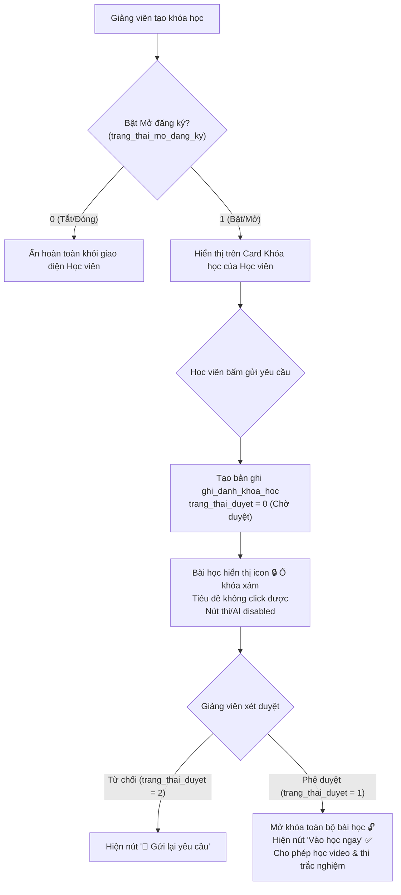

# 📘 EDU MIND AI – CONTEXT & SYSTEM ARCHITECTURE DOCUMENTATION
> **Tài liệu toàn diện về bối cảnh kỹ thuật, kiến trúc mã nguồn, cơ sở dữ liệu và quy tắc nghiệp vụ hệ thống EduMind AI.**  
> *Dành cho các AI Assistant & Kỹ sư phần mềm tiếp nhận dự án mà không cần quét lại toàn bộ mã nguồn.*

---

## 1. TỔNG QUAN HỆ THỐNG (PROJECT OVERVIEW)

- **Tên dự án:** **EduMind AI** – Nền tảng Quản lý Học tập Trực tuyến (E-Learning) tích hợp Trợ lý Trí tuệ Nhân tạo Thông minh.
- **Mục tiêu cốt lõi:**
  1. Cung cấp nền tảng quản trị và giảng dạy trực tuyến linh hoạt cho Quản trị viên và Giảng viên.
  2. Ứng dụng **Google Gemini API** (mô hình `gemini-1.5-flash`) tự động sinh đề thi trắc nghiệm theo bài học, chống trùng lặp câu hỏi thông minh.
  3. Cung cấp **Trợ lý học tập AI (Chatbot Widget)** có khả năng hiểu ngữ cảnh bài học, phân tích văn bản và hình ảnh bài tập (Multimodal).
  4. Quản lý chặt chẽ quy trình ghi danh học tập: Giảng viên kiểm duyệt học viên trước khi cấp quyền truy cập toàn bộ bài học và bài thi.
- **Stack công nghệ chính:**
  - **Backend:** PHP 8.x, Laravel Framework 9.x / 10.x.
  - **Database:** MySQL / MariaDB (chạy qua XAMPP).
  - **Frontend:** Laravel Blade Templates, Bootstrap 5.3, Bootstrap Icons, Font Awesome 6.
  - **Client Scripting:** JavaScript ES6 thuần, Axios / Fetch API.
  - **AI Engine:** Google Gemini Generative AI API (Model ưu tiên: `gemini-1.5-flash`, `gemini-flash-latest`, `gemini-flash-lite-latest`, `gemini-pro-latest`).
  - **Lưu trữ tệp:** Thư mục `public/uploads/khoa_hoc/` và `storage/app/public/` (kết nối qua `storage:link`).

---

## 2. CẤU TRÚC THƯ MỤC CHÍNH (DIRECTORY MAP)

```
c:\xampp\htdocs\elearning-ai\
├── app/
│   ├── Http/
│   │   ├── Controllers/         # Bộ điều khiển trung tâm (Controller)
│   │   │   ├── AiTaoDeThiController.php     # Sinh đề trắc nghiệm AI Gemini, nộp bài, chấm điểm & xem kết quả
│   │   │   ├── GiangVienController.php      # Bàn làm việc Giảng viên (Khóa học, Chương, Bài học, Đề thi, Duyệt học viên)
│   │   │   ├── HocVienController.php        # Bảng điều khiển Học viên (Đăng ký học, Xem bài học, Làm bài thi)
│   │   │   ├── QuanTriController.php        # Bàn làm việc Quản trị viên (KPI, Danh mục, Khóa học, Phân công GV, Đề thi, Tài khoản)
│   │   │   ├── ThiTracNghiemController.php  # Hiển thị giao diện làm bài thi trắc nghiệm
│   │   │   ├── TroLyAiController.php        # API Chatbot AI Gemini (Multimodal: Nhận văn bản & ảnh bài tập)
│   │   │   └── XacThucController.php        # Đăng nhập, Đăng ký, Đăng xuất, Đổi mật khẩu cá nhân
│   │   └── Middleware/          # Lớp lọc trung gian phân quyền & bảo mật
│   │       ├── Authenticate.php             # Xác thực người dùng đã đăng nhập
│   │       ├── KiemTraQuanTri.php           # Phân quyền Quản trị viên (id_phan_quyen = 1)
│   │       ├── KiemTraGiangVien.php         # Phân quyền Giảng viên (id_phan_quyen = 2)
│   │       └── KiemTraHocVien.php           # Phân quyền Học viên (id_phan_quyen = 3) & hỗ trợ GV/Admin test đề
│   └── Models/                  # Eloquent Models & Quan hệ dữ liệu
│       ├── CauHoiKiemTra.php    # Câu hỏi trắc nghiệm (thuộc Đề thi, có nhiều Phương án)
│       ├── ChiTietBaiHoc.php    # Chi tiết bài học (thuộc Chương mục, có Đề thi, Video, Tóm tắt AI)
│       ├── ChiTietCauTraLoi.php # Đáp án học viên chọn cho từng câu hỏi trong lượt thi
│       ├── ChuongMucBaiHoc.php  # Chương mục (thuộc Khóa học, có nhiều Bài học)
│       ├── DanhMucKhoaHoc.php   # Danh mục đào tạo (chứa nhiều Khóa học)
│       ├── DeThiTracNghiem.php  # Đề thi trắc nghiệm (AI sinh hoặc soạn thủ công)
│       ├── GhiDanhKhoaHoc.php   # Bản ghi đăng ký khóa học của Học viên & trạng thái duyệt
│       ├── KhoaHoc.php          # Khóa học (thuộc Giảng viên, Danh mục, chứa nhiều Chương mục)
│       ├── LuotLamBaiThi.php    # Lịch sử thi, số điểm, kết quả xếp loại
│       ├── PhanQuyen.php        # Bảng phân quyền (Admin, Giảng viên, Học viên)
│       ├── PhuongAnLuaChon.php  # 4 phương án A, B, C, D của câu hỏi
│       └── User.php             # Tài khoản người dùng (ánh xạ bảng tai_khoan_nguoi_dung)
├── database/                    # Migrations & Seeders
├── public/
│   ├── uploads/khoa_hoc/        # Thư mục lưu ảnh đại diện (Thumbnail) Khóa học & Danh mục
│   └── storage/                 # Symbolic link trỏ tới storage/app/public/
├── resources/
│   └── views/                   # Giao diện Blade Templates
│       ├── components/
│       │   └── chatbot-widget.blade.php     # Floating Widget Trợ lý ảo AI Gemini (kèm upload ảnh)
│       ├── giang_vien/
│       │   └── tong_quan.blade.php          # Giao diện Tabs Hub Giảng viên (Khóa học, Đề thi, Duyệt học viên)
│       ├── hoc_vien/
│       │   ├── chi_tiet_bai_hoc.blade.php   # Giao diện học bài (Video, Tóm tắt AI, Playlist bài học)
│       │   ├── ket_qua_thi.blade.php        # Giao diện xem điểm số và giải thích đáp án
│       │   ├── lam_bai_thi.blade.php        # Giao diện làm bài thi trắc nghiệm có đồng hồ đếm ngược
│       │   └── tong_quan.blade.php          # Dashboard Học viên (Khóa học, Khóa bài chưa duyệt, AI Tạo Đề)
│       ├── layouts/
│       │   └── khung.blade.php              # Master Layout chung (Navbar, Footer, Bootstrap 5.3, Fonts)
│       ├── quan_tri/
│       │   ├── tong_quan.blade.php          # Dashboard Quản trị viên (Tabs Hub: KPI, Khóa học/DM, Đề thi, Tài khoản)
│       │   ├── khoa_hoc.blade.php           # Template quản lý Khóa học & Danh mục
│       │   ├── de_thi.blade.php             # Template giám sát Đề thi AI
│       │   └── tai_khoan.blade.php          # Template quản lý Người dùng & Phân quyền
│       ├── xac_thuc/
│       │   ├── dang_nhap.blade.php          # Trang đăng nhập
│       │   └── dang_ky.blade.php            # Trang đăng ký học viên mới
│       └── trang_chu.blade.php              # Trang chủ Landing Page giới thiệu nền tảng
└── routes/
    └── web.php                  # Định tuyến toàn bộ hệ thống (URL tiếng Việt chuẩn RESTful)
```

---

## 3. LƯỢC ĐỒ CƠ SỞ DỮ LIỆU CHI TIẾT (DATABASE SCHEMA)

Cơ sở dữ liệu sử dụng bảng mã `utf8mb4_unicode_ci`. Bảng dưới đây mô tả chính xác 100% cấu trúc thực tế trong database:

### 3.1. Bảng `phan_quyen` (Vai trò người dùng)
| Tên cột | Kiểu dữ liệu | Khóa | Ý nghĩa / Giá trị mẫu |
| :--- | :--- | :---: | :--- |
| `id_phan_quyen` | `bigint(20)` | PK | Khóa chính tự tăng |
| `ma_dinh_danh_quyen` | `varchar(50)` | UNIQUE | `quan_tri` (1), `giang_vien` (2), `hoc_vien` (3) |
| `ten_hien_thi_quyen`| `varchar(100)`| | Quản trị viên, Giảng viên, Học viên |
| `mo_ta_quyen_han` | `varchar(255)`| | Mô tả quyền hạn trong hệ thống |

### 3.2. Bảng `tai_khoan_nguoi_dung` (Tài khoản người dùng - Model `User`)
| Tên cột | Kiểu dữ liệu | Khóa | Ý nghĩa / Mô tả |
| :--- | :--- | :---: | :--- |
| `id_nguoi_dung` | `bigint(20)` | PK | Khóa chính tự tăng |
| `id_phan_quyen` | `bigint(20)` | FK | 1: Quản trị viên, 2: Giảng viên, 3: Học viên |
| `ho_va_ten` | `varchar(150)`| | Họ và tên hiển thị |
| `dia_chi_email` | `varchar(150)`| UNIQUE | Email dùng để đăng nhập |
| `mat_khau_ma_hoa` | `varchar(255)`| | Mật khẩu băm (Bcrypt Hash) |
| `so_dien_thoai` | `varchar(20)` | | Số điện thoại liên lạc |
| `duong_dan_anh_dai_dien`| `varchar(255)`| | Đường dẫn avatar người dùng |
| `gioi_thieu_ban_than` | `text` | | Tiểu sử / Bio |
| `trang_thai_tai_khoan` | `varchar(50)` | | `kich_hoat`, `tam_khoa`, `khoa` |
| `thoi_diem_dang_nhap_cuoi` | `timestamp` | | Lần đăng nhập gần nhất |
| `thoi_diem_tao` | `timestamp` | | Thời điểm tạo tài khoản |
| `thoi_diem_cap_nhat` | `timestamp` | | Thời điểm cập nhật cuối |

### 3.3. Bảng `danh_muc_khoa_hoc` (Danh mục đào tạo - Model `DanhMucKhoaHoc`)
| Tên cột | Kiểu dữ liệu | Khóa | Ý nghĩa / Mô tả |
| :--- | :--- | :---: | :--- |
| `id_danh_muc` | `bigint(20)` | PK | Khóa chính tự tăng |
| `ten_danh_muc` | `varchar(150)`| | Tên danh mục (ví dụ: Lập trình Web, Trí tuệ nhân tạo) |
| `duong_dan_than_thien_slug` | `varchar(180)`| UNIQUE | Slug định danh URL |
| `mo_ta_danh_muc` | `text` | | Tóm tắt mô tả nhóm khóa học |
| `thu_tu_hien_thi` | `int(11)` | | Thứ tự ưu tiên sắp xếp |
| `hinh_anh` | `varchar(255)`| | Ảnh đại diện danh mục (`uploads/khoa_hoc/...`) |

### 3.4. Bảng `khoa_hoc` (Khóa học - Model `KhoaHoc`)
| Tên cột | Kiểu dữ liệu | Khóa | Ý nghĩa / Mô tả |
| :--- | :--- | :---: | :--- |
| `id_khoa_hoc` | `bigint(20)` | PK | Khóa chính tự tăng |
| `id_giang_vien_phu_trach` | `bigint(20)`| FK | ID Giảng viên phụ trách (`tai_khoan_nguoi_dung`) |
| `id_danh_muc` | `bigint(20)` | FK | ID Danh mục đào tạo (`danh_muc_khoa_hoc`) |
| `tieu_de_khoa_hoc` | `varchar(255)`| | Tên/Tiêu đề khóa học |
| `duong_dan_than_thien_slug`| `varchar(255)`| UNIQUE | Đường dẫn thân thiện slug |
| `mo_ta_ngan_gon` | `varchar(500)`| | Tóm tắt nội dung khóa học |
| `noi_dung_gioi_thieu_chi_tiet`| `longtext` | | Bài viết giới thiệu chi tiết |
| `duong_dan_anh_bia` | `varchar(255)`| | Đường dẫn ảnh bìa (cũ) |
| `hinh_anh` | `varchar(255)`| | Ảnh Thumbnail (`uploads/khoa_hoc/...`) |
| `cap_do_khoa_hoc` | `varchar(50)` | | `co_ban`, `trung_binh`, `chuyen_sau` |
| `trang_thai_xuat_ban` | `varchar(50)` | | `xuat_ban` (Công khai), `cho_duyet`, `ban_nhap`, `tam_an` |
| `trang_thai_mo_dang_ky` | `tinyint(4)` | | **1: Mở đăng ký** (Học viên thấy và đăng ký), **0: Đóng đăng ký** (Ẩn khỏi học viên) |
| `tong_thoi_luong_phut` | `int(11)` | | Tổng thời lượng ước tính (phút) |
| `thoi_diem_tao` | `timestamp` | | Ngày tạo |
| `thoi_diem_cap_nhat` | `timestamp` | | Ngày cập nhật |

### 3.5. Bảng `chuong_muc_bai_hoc` (Chương mục bài học - Model `ChuongMucBaiHoc`)
| Tên cột | Kiểu dữ liệu | Khóa | Ý nghĩa / Mô tả |
| :--- | :--- | :---: | :--- |
| `id_chuong_muc` | `bigint(20)` | PK | Khóa chính tự tăng |
| `id_khoa_hoc` | `bigint(20)` | FK | Khóa học chứa chương mục này |
| `tieu_de_chuong_muc` | `varchar(255)`| | Tên chương mục |
| `mo_ta_chuong_muc` | `text` | | Mô tả chương mục |
| `thu_tu_sap_xep` | `int(11)` | | Thứ tự sắp xếp chương trong khóa học |

### 3.6. Bảng `chi_tiet_bai_hoc` (Bài học - Model `ChiTietBaiHoc`)
| Tên cột | Kiểu dữ liệu | Khóa | Ý nghĩa / Mô tả |
| :--- | :--- | :---: | :--- |
| `id_bai_hoc` | `bigint(20)` | PK | Khóa chính tự tăng (alias: `id_chi_tiet_bai_hoc`) |
| `id_chuong_muc` | `bigint(20)` | FK | Thuộc chương mục nào |
| `tieu_de_bai_hoc` | `varchar(255)`| | Tiêu đề bài học |
| `loai_bai_hoc` | `varchar(50)` | | `video`, `van_ban`, `tai_lieu` |
| `duong_dan_video_bai_giang` | `varchar(255)`| | Link YouTube (Embed/Watch) hoặc file video MP4 |
| `thoi_luong_video_giay` | `int(11)` | | **Lưu tổng số giây** (`phút * 60 + giây`) |
| `noi_dung_bai_hoc_chi_tiet` | `longtext` | | Nội dung văn bản chi tiết của bài học |
| `tom_tat_kien_thuc_cho_ai` | `text` | | Tóm tắt kiến thức trọng tâm dùng làm context cho Gemini AI |
| `duong_dan_tai_lieu_dinh_kem` | `varchar(255)`| | Đường dẫn file đính kèm |
| `cho_phep_hoc_thu` | `tinyint(1)` | | Trạng thái học thử (hệ thống hiện tại quản lý truy cập qua duyệt đăng ký) |
| `thu_tu_sap_xep` | `int(11)` | | Thứ tự bài học trong chương |

### 3.7. Bảng `ghi_danh_khoa_hoc` (Đăng ký học - Model `GhiDanhKhoaHoc`)
| Tên cột | Kiểu dữ liệu | Khóa | Ý nghĩa / Mô tả |
| :--- | :--- | :---: | :--- |
| `id_ghi_danh` | `bigint(20)` | PK | Khóa chính tự tăng |
| `id_hoc_vien` | `bigint(20)` | FK | ID Học viên (`tai_khoan_nguoi_dung`) |
| `id_khoa_hoc` | `bigint(20)` | FK | ID Khóa học (`khoa_hoc`) |
| `phan_tram_hoan_thanh` | `float` | | Tiến độ hoàn thành khóa học (0 - 100%) |
| `trang_thai_khoa_hoc` | `varchar(50)` | | `dang_hoc`, `hoan_thanh`, `tam_dung` |
| `trang_thai_duyet` | `tinyint(4)` | | **0: Chờ duyệt**, **1: Đã duyệt (Được học)**, **2: Từ chối** |
| `ngay_ghi_danh` | `timestamp` | | Thời điểm gửi yêu cầu đăng ký |
| `ngay_hoan_thanh` | `timestamp` | | Thời điểm hoàn thành khóa học |

### 3.8. Bảng `de_thi_trac_nghiem` (Đề thi - Model `DeThiTracNghiem`)
| Tên cột | Kiểu dữ liệu | Khóa | Ý nghĩa / Mô tả |
| :--- | :--- | :---: | :--- |
| `id_de_thi` | `bigint(20)` | PK | Khóa chính tự tăng |
| `id_bai_hoc` | `bigint(20)` | FK | Khóa ngoại trỏ tới `chi_tiet_bai_hoc` |
| `id_chi_tiet_bai_hoc` | `bigint(20)` | | Khóa ngoại phụ tương thích |
| `id_nguoi_tao` | `bigint(20)` | FK | ID Người tạo (Giảng viên, Admin, hoặc Học viên sinh đề) |
| `tieu_de_de_thi` | `varchar(255)`| | Tiêu đề đề thi (ví dụ: `Đề thi AI: ... (Lần 1)`) |
| `mo_ta_yeu_cau` | `text` | | Mô tả đề thi / yêu cầu đạt điểm |
| `thoi_luong_lam_bai_phut`| `int(11)` | | Thời gian làm bài tính bằng phút (`max(5, số_câu * 2)`) |
| `diem_so_toi_da` | `float` | | Thang điểm tối đa (mặc định 10.0) |
| `diem_so_qua_mon` | `float` | | Điểm đạt (mặc định 5.0) |
| `so_lan_lam_lai_toi_da` | `int(11)` | | Số lần được phép thi lại |
| `cho_phep_xem_loi_giai` | `tinyint(1)` | | 1: Cho phép xem giải thích chi tiết sau khi nộp |
| `trang_thai_mo_de` | `tinyint(1)` | | 1: Mở đề cho học viên làm, 0: Đóng đề |

### 3.9. Bảng `cau_hoi_kiem_tra` (Câu hỏi - Model `CauHoiKiemTra`)
| Tên cột | Kiểu dữ liệu | Khóa | Ý nghĩa / Mô tả |
| :--- | :--- | :---: | :--- |
| `id_cau_hoi` | `bigint(20)` | PK | Khóa chính tự tăng |
| `id_de_thi` | `bigint(20)` | FK | Đề thi chứa câu hỏi này |
| `noi_dung_cau_hoi` | `text` | | Nội dung câu hỏi trắc nghiệm |
| `giai_thich_chi_tiet_dap_an` | `text` | | Lời giải thích cặn kẽ đáp án từ Giảng viên hoặc AI |
| `nguon_goc_cau_hoi` | `varchar(50)` | | `ai_tao`, `giang_vien_soan`, `he_thong` |
| `trang_thai_kiem_duyet` | `varchar(50)` | | `da_duyet`, `cho_duyet` |
| `muc_do_kho` | `varchar(50)` | | `de`, `trung_binh`, `kho` |
| `diem_so_cau_hoi` | `float` | | Điểm của câu hỏi này (mặc định 1.0) |
| `thu_tu_hien_thi` | `int(11)` | | Thứ tự câu hỏi trong đề |

### 3.10. Bảng `phuong_an_lua_chon` (Phương án - Model `PhuongAnLuaChon`)
| Tên cột | Kiểu dữ liệu | Khóa | Ý nghĩa / Mô tả |
| :--- | :--- | :---: | :--- |
| `id_phuong_an` | `bigint(20)` | PK | Khóa chính tự tăng |
| `id_cau_hoi` | `bigint(20)` | FK | Câu hỏi chứa phương án này |
| `ky_tu_phuong_an` | `char(1)` | | Ký tự phương án: `A`, `B`, `C`, `D` |
| `noi_dung_phuong_an` | `text` | | Nội dung text của đáp án |
| `la_dap_an_chinh_xac` | `tinyint(1)` | | **1: Đáp án đúng**, **0: Đáp án sai** |

### 3.11. Bảng `luot_lam_bai_thi` (Lượt thi - Model `LuotLamBaiThi`)
| Tên cột | Kiểu dữ liệu | Khóa | Ý nghĩa / Mô tả |
| :--- | :--- | :---: | :--- |
| `id_luot_lam_bai` | `bigint(20)` | PK | Khóa chính tự tăng |
| `id_de_thi` | `bigint(20)` | FK | ID Đề thi đã làm |
| `id_hoc_vien` | `bigint(20)` | FK | ID Người làm bài (Học viên hoặc Giảng viên thi thử) |
| `lan_thi_thu` | `int(11)` | | Lần thi thứ mấy |
| `thoi_diem_bat_dau_lam`| `timestamp` | | Thời điểm bắt đầu tính giờ |
| `thoi_diem_nop_bai` | `timestamp` | | Thời điểm bấm nộp bài |
| `tong_so_cau_hoi` | `int(11)` | | Tổng số câu hỏi của đề |
| `so_cau_tra_loi_dung` | `int(11)` | | Số câu trả lời đúng |
| `tong_diem_dat_duoc` | `float` | | Điểm số đạt được (thang 10.0) |
| `ket_qua_xep_loai` | `varchar(50)` | | `dat` (>= điểm qua môn), `khong_dat`, `xuat_sac` |

### 3.12. Bảng `chi_tiet_cau_tra_loi` (Chi tiết câu trả lời - Model `ChiTietCauTraLoi`)
| Tên cột | Kiểu dữ liệu | Khóa | Ý nghĩa / Mô tả |
| :--- | :--- | :---: | :--- |
| `id_chi_tiet_tra_loi`| `bigint(20)` | PK | Khóa chính tự tăng |
| `id_luot_lam_bai` | `bigint(20)` | FK | Thuộc lượt làm bài nào |
| `id_cau_hoi` | `bigint(20)` | FK | Câu hỏi tương ứng |
| `id_phuong_an_da_chon`| `bigint(20)` | FK | Phương án học viên đã chọn |
| `danh_gia_dung_sai` | `tinyint(1)` | | 1: Trả lời đúng, 0: Trả lời sai |

### 3.13. Bảng `lich_su_tro_giang_ai` (Nhật ký Chatbot AI)
| Tên cột | Kiểu dữ liệu | Khóa | Ý nghĩa / Mô tả |
| :--- | :--- | :---: | :--- |
| `id_hoi_dap` | `bigint(20)` | PK | Khóa chính tự tăng |
| `id_hoc_vien` | `bigint(20)` | FK | Học viên đặt câu hỏi |
| `id_bai_hoc` | `bigint(20)` | FK | Ngữ cảnh bài học đang xem (nếu có) |
| `noi_dung_cau_hoi_hoc_vien` | `text` | | Câu hỏi học viên nhập |
| `ngu_canh_bai_hoc_gui_ai` | `text` | | Ngữ cảnh bài học kèm theo khi gửi Gemini |
| `cau_tra_loi_tu_ai` | `longtext` | | Phản hồi định dạng Markdown từ Gemini |
| `ten_mo_hinh_ai_su_dung` | `varchar(50)` | | Model đã phản hồi (ví dụ: `gemini-1.5-flash`) |
| `thoi_diem_hoi_dap` | `timestamp` | | Thời gian tương tác |

---

## 4. CÁC LUỒNG NGHIỆP VỤ CỐT LÕI (CORE BUSINESS LOGIC)

### 4.1. Luồng 1: Phân Quyền & Quản Lý Truy Cập Khóa Học


- **Quy tắc bảo mật cấp Controller (`HocVienController@showLesson` / `chiTietBaiHoc`):**
  - Quản trị viên (`id_phan_quyen == 1`) và Giảng viên sở hữu khóa học được phép truy cập xem mọi lúc.
  - Mọi tài khoản Học viên (`id_phan_quyen == 3`) bắt buộc phải tồn tại bản ghi `GhiDanhKhoaHoc` với `trang_thai_duyet == 1`.
  - Nếu học viên chưa đăng ký hoặc chưa được duyệt mà cố tình nhập trực tiếp URL bài học, Controller lập tức chuyển hướng về trang tổng quan kèm thông báo lỗi:
    > *"Khóa học này đang chờ giảng viên phê duyệt, bạn chưa thể truy cập bài học!"*

### 4.2. Luồng 2: Sinh Đề Thi Trắc Nghiệm Thông Minh Bằng Gemini AI
- **Quyền hạn & Giới hạn:**
  - **Giảng viên:** Không bị giới hạn số lần sinh đề AI. Được tạo đề AI trực tiếp từ bài học hoặc modal độc lập.
  - **Học viên:** Được chọn số câu hỏi mong muốn (**3 câu, 5 câu, 10 câu**). Giới hạn tối đa **3 lần** tạo đề thi AI cho mỗi bài học (`soLanDaTao >= 3` sẽ bị khóa nút và thông báo lỗi).
- **Cơ chế chống trùng lặp câu hỏi (Deduplication):**
  - Quét toàn bộ câu hỏi đã tồn tại trong các đề thi của bài học này (`CauHoiKiemTra`).
  - Đưa danh sách 15 câu gần nhất vào prompt gửi Gemini API kèm chỉ thị nghiêm ngặt:
    > *"CÁC CÂU HỎI ĐÃ CÓ (TUYỆT ĐỐI KHÔNG TẠO TRÙNG HOẶC TƯƠNG TỰ VỀ NỘI DUNG VỚI DANH SÁCH NÀY): ..."*
- **Quy chuẩn thời gian làm bài:**
  - Tự động tính toán theo số lượng câu hỏi: `thoi_luong_lam_bai_phut = max(5, so_luong_cau_hoi * 2)` (khoảng 1.5 - 2 phút/câu).
- **Cơ chế Fallback đa tầng:**
  - Nếu kết nối Gemini API gặp sự cố (timeout, rate limit), hệ thống tự động fallback qua ngân hàng câu hỏi chuẩn sư phạm đã được lọc chống trùng, đảm bảo học viên luôn có đề thi để ôn tập tức thì.

### 4.3. Luồng 3: Quản Lý Bài Học & Thời Lượng Video
- **Giao diện nhập liệu:**
  - Cung cấp 2 ô riêng biệt: **Phút** (`thoi_luong_phut`) và **Giây** (`thoi_luong_giay`, giới hạn 0 - 59).
- **Lưu trữ CSDL:**
  - Quy đổi thành tổng số giây lưu vào cột `thoi_luong_video_giay` trong bảng `chi_tiet_bai_hoc`:
    $$\text{thoi\_luong\_video\_giay} = (\text{phút} \times 60) + \text{giây}$$
- **Model Accessors (`ChiTietBaiHoc.php`):**
  - `$baiHoc->thoi_luong_hien_thi`: Trả về chuỗi format thân thiện: `10p 30s` hoặc `15 phút` hoặc `45 giây`.
  - `$baiHoc->thoi_luong_phut`: Tự động tách phần phút nguyên để điền vào form sửa.
  - `$baiHoc->thoi_luong_giay`: Tự động tách phần giây dư để điền vào form sửa.

### 4.4. Luồng 4: Trợ Lý Học Tập AI Gemini (Chatbot Widget)
- **Đặc điểm & Khả năng:**
  - Tích hợp tại `resources/views/components/chatbot-widget.blade.php`, hiển thị nổi ở góc màn hình.
  - Hỗ trợ **Multimodal**: Cho phép học viên gửi kèm ảnh bài tập, sơ đồ hoặc thông báo lỗi code (JPG, PNG, WEBP tối đa 5MB).
  - Tự động thu thập ngữ cảnh bài học hiện tại (`lesson_id`, tiêu đề, `tom_tat_kien_thuc_cho_ai`) để Gemini trả lời chính xác, sát giáo trình.
  - Phản hồi bằng tiếng Việt, định dạng Markdown rõ ràng, xưng hô thân thiện (*"EduMind AI - bạn"*).

---

## 5. BẢNG PHÂN QUYỀN & MÃ PHÂN QUYỀN HỆ THỐNG

| ID | Mã quyền | Tên quyền | Trang tổng quan chính | Middleware | Quyền hạn tiêu biểu |
| :---: | :--- | :--- | :--- | :--- | :--- |
| **1** | `quan_tri` | Quản trị viên (Admin) | `/quan-tri/tong-quan` | `quan_tri` | Toàn quyền hệ thống: Quản lý danh mục, khóa học, duyệt xuất bản, phân công GV, xóa tài khoản, reset mật khẩu, giám sát toàn bộ đề thi AI. |
| **2** | `giang_vien` | Giảng viên (Lecturer) | `/giang-vien/tong-quan` | `giang_vien` | Tạo & quản lý khóa học, chương mục, bài giảng video, soạn đề thủ công, sinh đề AI không giới hạn, duyệt/từ chối học viên đăng ký, thi thử bài thi. |
| **3** | `hoc_vien` | Học viên (Student) | `/hoc-vien/tong-quan` | `hoc_vien` | Xem khóa học mở đăng ký, gửi yêu cầu đăng ký, học bài giảng (khi đã được duyệt), thi trắc nghiệm, tạo đề thi AI (tối đa 3 lần/bài), chat với Trợ lý AI. |

---

## 6. QUY TẮC PHÁT TRIỂN & CHỈNH SỬA CODE (AI CODING RULES)

Khi làm việc trên dự án **EduMind AI**, mọi AI Assistant và lập trình viên **BẮT BUỘC** tuân thủ các nguyên tắc sau:

1. **Nguyên tắc Thay đổi Tối thiểu (Minimal Change):**
   - Chỉ chỉnh sửa đúng các file, method và dòng mã được yêu cầu trong tác vụ.
   - Tuyệt đối **KHÔNG** tự ý refactor mã nguồn ngoài phạm vi, không đổi tên các bảng cơ sở dữ liệu hiện có (`khoa_hoc`, `chi_tiet_bai_hoc`, `de_thi_trac_nghiem`, `ghi_danh_khoa_hoc`,...).
2. **Bảo toàn Tính Tương thích (Backward Compatibility):**
   - Hệ thống có nhiều alias tương thích cho cả tên tiếng Việt và URL cũ:
     - `tieu_de_khoa_hoc` $\leftrightarrow$ `ten_khoa_hoc`.
     - `id_bai_hoc` $\leftrightarrow$ `id_chi_tiet_bai_hoc`.
     - `thoi_luong_lam_bai_phut` $\leftrightarrow$ `thoi_gian_lam_bai`.
     - Route: `/dang-nhap` $\leftrightarrow$ `/login`, `/tong-quan` $\leftrightarrow$ `/dashboard`.
   - Giữ nguyên các alias này trong Model và Route để tránh gãy các liên kết cũ.
3. **Tiêu chuẩn Giao diện (UI/UX Conventions):**
   - Bàn làm việc Quản trị viên và Giảng viên luôn sử dụng layout toàn màn hình: `<div class="container-fluid px-4">`.
   - Cột **"THAO TÁC"** trong các bảng quản trị luôn bọc các nút bấm trong container flexbox căn giữa có khoảng cách đệm rõ ràng:
     ```html
     <div class="d-flex align-items-center justify-content-center gap-2">
         <button class="btn btn-sm ... rounded-2 px-2 py-1">...</button>
     </div>
     ```
   - Tuyệt đối không dùng class `btn-group` làm dính mép các nút thao tác.
4. **Quy chuẩn Hình ảnh & Uploads:**
   - Ảnh đại diện Khóa học & Danh mục lưu tại `public/uploads/khoa_hoc/`.
   - Khi cập nhật ảnh mới, luôn xóa file ảnh cũ trên đĩa (`@unlink(public_path(...))`) để tránh rác dung lượng.
   - Thẻ `` luôn bọc kiểm tra `file_exists(public_path(...))` và có fallback icon mặc định (`<i class="bi bi-book fs-1"></i>` hoặc `<i class="fa-solid fa-graduation-cap"></i>`).
5. **Kiểm tra sau khi chỉnh sửa:**
   - Luôn chạy kiểm tra cú pháp PHP: `php -l <file_path>`.
   - Chạy lệnh dọn dẹp cache view và route sau khi thay đổi Blade/Route:
     ```powershell
     php artisan view:clear
     php artisan route:clear
     ```
